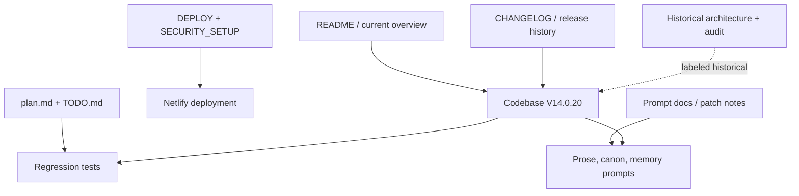

# Documentation Audit Report — Xưởng Truyện AI V14.0.20

> **Project:** Xưởng Truyện AI
> **Audited:** 2026-10-22
> **Scope:** Toàn bộ tài liệu Markdown trong project + đối chiếu với codebase và test suite
> **Documents reviewed:** 54 Markdown files
> **Code alignment:** Có
> **Audit mode:** Initial read-only audit; remediation applied after user approval

> **Remediation status:** Hoàn tất remediation. Các findings MAJ-001–MAJ-004, MIN-001–MIN-006 đã được xử lý hoặc giảm thiểu; toàn bộ 5 bộ E2E đã PASS và README đã có architecture guide V14 current.

## Executive Summary

Codebase V14.0.20 hiện có cấu trúc và regression coverage tốt: `npm test` hoàn thành với toàn bộ test logic và 5 bộ E2E PASS, shared-core sync PASS, syntax PASS và không có Markdown link hỏng. Version metadata, README overview, security guide, implementation plan, architecture guide V14 current và banner cho tài liệu lịch sử hiện đã nhất quán với V14.0.20.

Không phát hiện Critical, Major hoặc Minor finding còn tồn đọng. Các tài liệu V12/V13 còn chứa version cũ nhưng đã được đặt trong ngữ cảnh lịch sử hoặc release history, không phải current specification.

## Findings Summary

| Severity | Count | Categories |
|---|---:|---|
| Critical | 0 | Không phát hiện |
| Major | 0 | Không phát hiện mới sau remediation |
| Minor | 0 | Không còn finding tồn đọng |
| Info | 2 | Documentation index; automated version-authority check |

## Audit Evidence

- **Documentation inventory:** 54 file Markdown, gồm README/root docs, architecture/audit docs, security/deployment docs, plan/TODO/validation, audit report và patch notes.
- **Syntax:** `node --check netlify/functions/write-chapter-background.js` — PASS; `node --check scripts/sync-shared.js` — PASS.
- **Regression:** `npm test` — tất cả test logic và 5 bộ E2E PASS (`e2e.py`, `e2e_v14_0_15.py`, `e2e_bg.py`, `e2e_bg_slim.py`, `e2e_delete.py`).
- **Link hygiene:** không phát hiện Markdown link tương đối trỏ tới file không tồn tại.
- **Current implementation markers:** code có `vietnameseNovelWritingPrompt`, `isAcceptedStoryChapter`, `activeStoryChapters`, `acceptedStoryChapters`, `PLAN_REJECTED`, adaptive scene validator và Character Canon postprocess barrier.

## Document Inventory

| Category | Approx. count | Representative files | Assessment |
|---|---:|---|---|
| Meta / overview | 3 | `README.md`, `CHANGELOG.md`, `PROMPT_OPTIMIZER_AUDIT.md` | Có thông tin phong phú; current version đã nhất quán |
| Architecture / audit | 2 | `docs/ARCHITECTURE.md`, `docs/AUDIT_COMPLETE_CHAPTER_V14.md` | Đã gắn banner historical; kiến trúc V14 current nằm trong README |
| Guide / operations | 3 | `DEPLOY.md`, `SECURITY_SETUP.md`, `TODO.md` | Hữu ích và đã cập nhật version/checklist |
| Plan / validation | 2 | `plan.md`, `VALIDATION_V1233.md` | Plan V14 ghi rõ trạng thái V14.0.20; validation V12 được giữ lịch sử |
| Prompt / feature reference | 2 | `docs/PROMPT_V12.22.md`, `docs/patch-notes/PROMPT_V12.22.md` | Tài liệu prompt phiên bản cũ, cần nhãn historical rõ hơn |
| Patch notes / release history | 41 | `docs/patch-notes/*.md` | Tốt cho truy vết lịch sử; không nên được hiểu là current specification |

## Major Findings

### MAJ-001: README và package version không nhận diện V14.0.20 [RESOLVED]

- **Location:** `README.md:4`, `README.md:36`; `package.json:4`.
- **Issue:** README tuyên bố “Bản hiện tại: V14.0.16”, còn `package.json` vẫn là `14.0.16`, trong khi code/changelog đã ở V14.0.20.
- **Evidence:** `CHANGELOG.md:3–9` ghi V14.0.20; code có comment `V14.0.20` và helper `vietnameseNovelWritingPrompt` trong `shared/core.js:335–356`; giao diện vẫn hiển thị `v14.0.16` ở `index.html:29`.
- **Impact:** Người deploy, người đọc báo lỗi và CI/release tooling có thể xác định nhầm phiên bản; tính năng Vietnamese Novel Writing và Character Canon Manager không xuất hiện trong overview hiện hành.
- **Fix:** Chọn một version authority duy nhất. Cập nhật `package.json`, brand/version trong `index.html`, dòng current version trong `README.md`, sau đó thêm checklist kiểm tra không còn version cũ ở các vị trí current-facing.

### MAJ-002: Báo cáo `AUDIT_COMPLETE_CHAPTER_V14.md` phủ định trạng thái code hiện tại [RESOLVED]

- **Location:** `docs/AUDIT_COMPLETE_CHAPTER_V14.md:5–7, 22–26, 32–46, 143–145`.
- **Issue:** Tài liệu kết luận app “không có Chapter Contract bất biến”, Scene Graph chưa phải barrier cấp dữ liệu, chưa có plan validator và cần triển khai các thành phần này. Đây là mô tả không còn đúng với V14.0.20.
- **Evidence:** `shared/core.js:210–212` validate Scene Graph; `shared/core.js:2322–2370` chạy adaptive pipeline và trả `PLAN_REJECTED`; `tests/v13_adaptive_scene.test.js` và `tests/v14_worker_draft.test.js` kiểm tra contract/plan rejection; `CHANGELOG.md:32–39` ghi các tính năng V14.0.16 đã triển khai.
- **Impact:** Đây là tài liệu có tên “Audit” và các khuyến nghị của nó dễ được coi là backlog hiện tại, dẫn tới sửa trùng, đánh giá sai rủi ro hoặc rollback tư duy kiến trúc đã hoàn thiện.
- **Fix:** Giữ file như historical audit nhưng đổi tiêu đề thành `Historical Audit — pre-V14 contract design`, thêm banner đầu file: “Không phải current specification; các đề xuất A–G đã được triển khai một phần/toàn bộ ở V14.0.x”. Tạo liên kết sang báo cáo này và `CHANGELOG.md`.

### MAJ-003: `plan.md` vẫn mô tả worker Scene Graph là việc sẽ làm sau [RESOLVED]

- **Location:** `plan.md:20–23, 25–32`.
- **Issue:** Plan nói background worker “sau khi client ổn định sẽ thêm nhánh scene worker”, và trạng thái dừng ở V13.6/V14 chung chung. Code hiện đã có worker `runAdaptiveChapterPipeline` và comment V14.0.6 xác nhận worker dùng pipeline adaptive.
- **Evidence:** `netlify/functions/write-chapter-background.js:4066–4097` gọi adaptive pipeline; `tests/v14_worker_draft.test.js:1,72` kiểm tra worker dùng Chapter Contract + Scene Graph; `CHANGELOG.md:34` ghi parity client/worker.
- **Impact:** Người phát triển có thể triển khai lại nhánh worker đã tồn tại hoặc đánh giá sai mức độ hoàn thành của pipeline.
- **Fix:** Đổi `plan.md` thành `plan-archive.md` hoặc thêm mục “Status as of V14.0.20”; đánh dấu các dòng worker/contract đã hoàn thành; chuyển các việc còn lại thành backlog có mã issue rõ ràng.

### MAJ-004: Tài liệu current-facing chưa bao phủ ba release V14.0.17–V14.0.20 [RESOLVED]

- **Location:** `README.md:4–48`; cấu trúc docs trong `README.md:50–58`.
- **Issue:** README liệt kê đến V14.0.16 rồi quay lại V12.47.1, không có phần tóm tắt cho prompt provenance/active-record memory, Character Canon Manager và Vietnamese prose contract. `CHANGELOG.md` có nội dung nhưng footer vẫn tuyên bố bản mới nhất là V12.47.1 ở khoảng dòng 232.
- **Evidence:** `CHANGELOG.md:3–30` đã có bốn release V14 mới; `shared/core.js:421–467` có active/accepted chapter và hint verification; `netlify/functions/write-chapter-background.js:4920–4935` có accepted-only postprocess guard; `shared/core.js:337–354` có prose contract.
- **Impact:** Người dùng chỉ đọc README sẽ không biết các hàng rào canon/memory và chất lượng văn xuôi mới, trong khi changelog chứa thông tin đúng nhưng footer lại chỉ tới version cũ.
- **Fix:** Thêm mục “V14.0.17–V14.0.20 hiện hành” vào README, mô tả ngắn bốn thay đổi và link tới changelog/audit. Sửa footer changelog thành V14.0.20 hoặc thay bằng liên kết tới release heading đầu tiên.

## Minor Findings

### MIN-001: `package.json` version stale làm metadata phát hành lệch code [RESOLVED]

- **Location:** `package.json:4`.
- **Issue:** Version `14.0.16` không phản ánh V14.0.20.
- **Impact:** Artifact, log, package inspection và các công cụ release có thể gắn nhãn sai.
- **Fix:** Cập nhật `14.0.20`; bổ sung test đơn giản đối chiếu package version với current release marker nếu project tiếp tục dùng version trong file.

### MIN-002: `SECURITY_SETUP.md` vẫn đề tiêu đề V12.33 [RESOLVED]

- **Location:** `SECURITY_SETUP.md:1`.
- **Issue:** Nội dung bảo mật có vẻ vẫn hữu ích, nhưng tiêu đề phiên bản cũ khiến người đọc không biết đây là hướng dẫn còn hiệu lực hay tài liệu lịch sử.
- **Impact:** Giảm niềm tin và có thể khiến người dùng bỏ qua các biến bảo mật mới/đã thay đổi.
- **Fix:** Đổi thành “Cấu hình bảo mật hiện hành — V14.0.20”, thêm mục “đã kiểm tra với code” và link tới `netlify/functions/security-status.js`, `lib/security.js`.

### MIN-003: TODO vẫn để mục đã hoàn thành ở trạng thái chưa làm [RESOLVED]

- **Location:** `TODO.md:31–35`.
- **Issue:** `npm test` và sync check hiện đã chạy PASS trong audit, nhưng `Chạy full test và kiểm tra sync shared core` vẫn `[ ]`.
- **Impact:** Checklist không phản ánh trạng thái thực tế và có thể làm trùng công việc.
- **Fix:** Đánh dấu mục đã thực hiện với ngày/commit; giữ riêng các mục E2E chưa chạy vì dependency thiếu. Cập nhật heading V14.0.16 thành “V14.0.x — Scene and prose quality follow-up”.

### MIN-004: `docs/ARCHITECTURE.md` trộn tài liệu lịch sử với mô tả vận hành hiện tại [MITIGATED]

- **Location:** `docs/ARCHITECTURE.md:1–16, 45–70, 140–166`.
- **Issue:** File đã tự nhận là README cũ nhưng vẫn chứa các câu hướng dẫn hiện tại như “bấm Viết chương nền”, flow v9, storage và background flow có thể khác pipeline hiện tại.
- **Impact:** Người đọc có thể dùng nhầm flow cũ để deploy/vận hành V14.0.20.
- **Fix:** Đổi tên/đặt rõ `Historical Architecture`; rút phần current operations ra một tài liệu architecture hiện hành ngắn, có sơ đồ client → job → adaptive worker → quality gate → postprocess → canon barrier.

## Observations & Suggestions

### MIN-005: Chưa hoàn tất xác minh E2E trong môi trường audit [RESOLVED]

- **Evidence:** `npm test` PASS toàn bộ test logic nhưng SKIP 5 nhóm E2E vì sandbox thiếu Playwright/Python.
- **Impact:** Chưa đủ bằng chứng để gọi bản build là release-verified ở cấp giao diện, background job và luồng xóa chương.
- **Fix:** Cài dependency E2E và chạy lại `tests/e2e.py`, `tests/e2e_v14_0_15.py`, `tests/e2e_bg.py`, `tests/e2e_bg_slim.py` và `tests/e2e_delete.py` trong CI/release environment.

### MIN-006: Chưa có architecture guide V14 current riêng [RESOLVED]

- **Evidence:** `docs/ARCHITECTURE.md` đã được đánh dấu historical; current behavior đang phân tán giữa `README.md`, `plan.md`, `DEPLOY.md` và `CHANGELOG.md`.
- **Impact:** Người mới vẫn phải ghép nhiều tài liệu để hiểu flow client → adaptive worker → Quality Gate → postprocess → Canon barrier.
- **Fix:** Trong lần tài liệu tiếp theo, cập nhật một tài liệu architecture current; không cần xử lý khẩn cấp vì banner historical đã loại bỏ nguy cơ hiểu nhầm lớn nhất.

### INFO-001: Nên có một “version authority” được link từ mọi tài liệu current-facing

- **Location:** `README.md`, `CHANGELOG.md`, `package.json`, `index.html`.
- **Suggestion:** Chọn `package.json` hoặc một file `VERSION` làm nguồn chuẩn, rồi để README/brand/changelog kiểm tra theo nguồn đó. Không cần sửa các patch note lịch sử.

### INFO-002: Nên phân biệt rõ historical patch notes và current specification

- **Location:** `docs/patch-notes/`, `docs/PROMPT_V12.22.md`, `docs/ARCHITECTURE.md`.
- **Suggestion:** Thêm front matter hoặc banner `Historical — applies to Vx.y` và một `docs/README.md` làm index: Current / Historical / Audit / Operations.

### INFO-003: Nên đưa giới hạn kiểm thử E2E vào release checklist [RESOLVED]

- **Evidence:** Sau remediation, `npm test` chạy PASS cả logic và 5 nhóm E2E; checklist hiện không còn coi E2E là chưa xác minh.
- **Suggestion:** Tiếp tục giữ distinction “logic CI green” và “release verified” trong các release sau.

## Coverage Map

## Recommended Priority Actions

1. **Documentation tooling — small effort:** thêm kiểm tra tự động đối chiếu `package.json` version với current README/brand marker.
2. **Documentation navigation — small effort:** có thể thêm index phân biệt Current / Historical / Audit / Operations nếu project tiếp tục mở rộng.

## Conclusion

V14.0.20 hiện có code/test/documentation alignment tốt và không có bằng chứng về lỗi runtime nghiêm trọng từ audit này. Các findings version/documentation drift của vòng audit trước đã được xử lý; toàn bộ logic tests và E2E đều PASS. Chỉ còn hai đề xuất cải thiện không chặn phát hành: tự động kiểm tra version authority và bổ sung index tài liệu khi cần.
